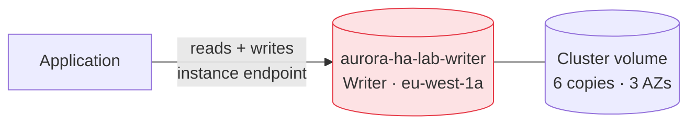
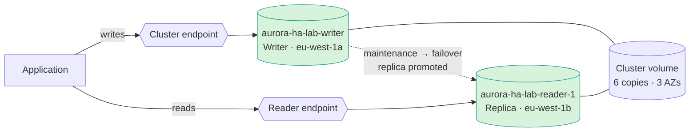
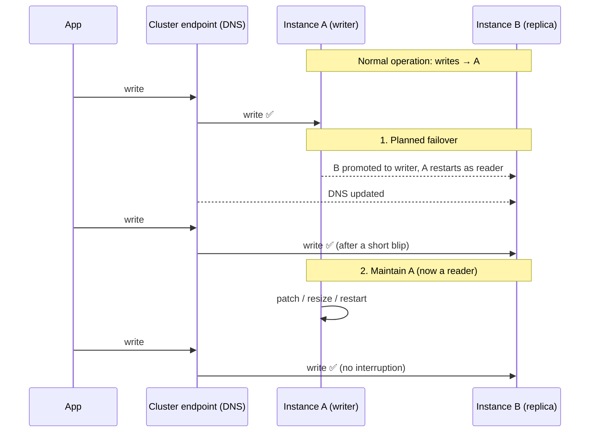
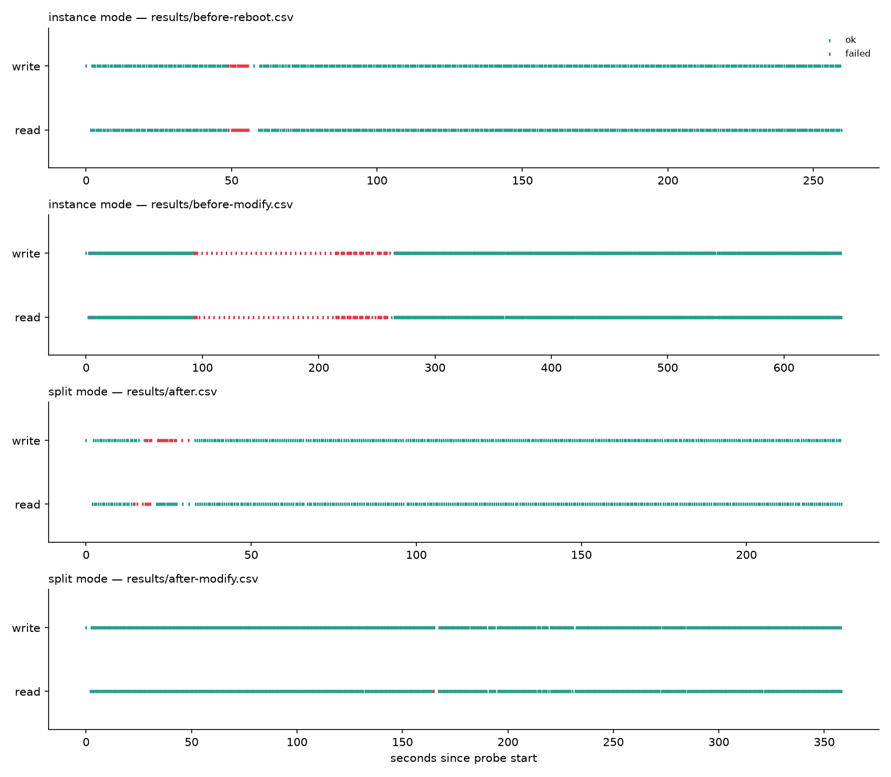

# Zero-Downtime Maintenance on Amazon Aurora

*A hands-on lab that reproduces a real high-availability problem on Amazon Aurora,
measures the outage, applies the fix, and measures again, with real numbers
from real AWS infrastructure.*


---

## Table of contents

1. [TL;DR](#tldr)
2. [The scenario](#the-scenario)
3. [The answer and why it works](#the-answer-and-why-it-works)
4. [Background: how Aurora is built](#background-how-aurora-is-built)
5. [Architecture](#architecture)
6. [How the experiment works](#how-the-experiment-works)
7. [Results](#results)
8. [Key finding: stale DNS can undo the fix](#key-finding-stale-dns-can-undo-the-fix)
9. [Why the other options don't work](#why-the-other-options-dont-work)
10. [Repository structure](#repository-structure)
11. [Run it yourself](#run-it-yourself)
12. [Troubleshooting](#troubleshooting)
13. [Cost and security](#cost-and-security)
14. [Limitations](#limitations)
15. [What I learned](#what-i-learned)
16. [Next steps](#next-steps)

---

## TL;DR

| | Single instance (before) | Writer + replica (after) |
|---|---|---|
| Write downtime during the same maintenance action | **171.6 s** | **0 s** |
| Read downtime during the same maintenance action | **169.6 s** | 2.2 s |
| One-off cost of the fix | none | a planned failover (14.8 s of write errors) and a second instance |

With one Aurora instance, a maintenance action that replaced the instance took
the application **fully offline for almost 3 minutes**. After adding an Aurora
Replica in a second Availability Zone and pointing the application at the
**cluster** and **reader** endpoints, the same maintenance caused **zero write
failures**.

The experiment also surfaced a problem the textbook answer doesn't mention:
**my ISP's DNS resolver served an outdated address for the cluster endpoint**,
which made the "fixed" setup time out until I switched resolvers.

---

## The scenario

> A company is using an Amazon Aurora cluster as the data store for its
> application. The Aurora cluster is configured with a **single DB instance**.
> The application performs read and write operations on the database by using
> the cluster's **instance endpoint**.
>
> The company has scheduled an update to be applied to the cluster during an
> upcoming maintenance window. The cluster must remain available with the
> **least possible interruption** during the maintenance window.
>
> What should a DevOps engineer do to meet these requirements?

This is a common AWS DevOps Engineer – Professional style question. Instead of
just memorising the answer, this project **builds the setup, breaks it, fixes
it and proves the fix with data**.

---

## The answer and why it works

> **Add a reader instance (an Aurora Replica) to the cluster in a different
> Availability Zone. Update the application to send writes to the cluster
> (writer) endpoint and reads to the reader endpoint.**

The scenario hides **two separate problems**, and the fix has to address both:

| Problem | Why it hurts | What fixes it |
|---|---|---|
| **1. Only one instance** | When that instance is patched or restarted there is nothing else to serve traffic: a single point of failure. | **Add an Aurora Replica.** Aurora can promote it to writer while the original instance is maintained. |
| **2. The app uses an instance endpoint** | An instance endpoint is permanently tied to *one* instance. Even if a replica took over, the app would keep connecting to the instance being patched. | **Use the cluster endpoint for writes.** It always points at whichever instance is currently the writer, and follows a failover automatically. Use the **reader endpoint** for reads. |

Fixing only one of the two isn't enough:

- A replica **with** the instance endpoint means the app is still pinned to the instance being patched.
- The cluster endpoint **without** a replica means there is still nothing to fail over to.

---

## Background: how Aurora is built

Understanding three concepts makes the answer obvious.

### 1. Compute and storage are separate

An Aurora **cluster** has one shared **cluster volume** (storage) and one or
more **DB instances** (compute) attached to it. The volume keeps **six copies of
the data across three Availability Zones**. Instances don't own data; they all
read the same volume.

Promoting a replica to writer therefore **copies no data**. Aurora just changes
which instance is allowed to write, which is why failover takes seconds, not
minutes.

### 2. Instance roles

| Role | How many | Can write? |
|---|---|---|
| **Writer** (primary) | exactly 1 | yes |
| **Reader** (Aurora Replica) | 0–15 | no, read-only |

Each replica has a **promotion tier** (0–15). On failover, Aurora promotes the
replica with the highest priority (lowest tier number). In this project the
original writer is tier 0 and the replica is tier 1.

### 3. Endpoints

| Endpoint | Points to | Follows failover? | Use for |
|---|---|---|---|
| **Cluster (writer) endpoint** `name.cluster-xxxx...` | the current writer | ✅ yes | writes, and reads that must see the latest data |
| **Reader endpoint** `name.cluster-ro-xxxx...` | load-balanced across replicas (falls back to the writer if there are none) | ✅ yes | reads |
| **Instance endpoint** `instance-name.xxxx...` | one specific instance, forever | ❌ no | diagnostics and targeted tuning only |
| **Custom endpoint** | a group of instances you choose | partly | special workloads (e.g. analytics replicas) |

Endpoints are DNS names. A failover works by **AWS updating the DNS record**
behind the cluster endpoint. That detail turned out to matter a lot (see the
[key finding](#key-finding-stale-dns-can-undo-the-fix)).

---

## Architecture

### Before: single point of failure



### After: failover-ready



### Maintenance procedure with the fix



---

## How the experiment works

### Components

| Component | What it does |
|---|---|
| **Terraform** (`terraform/`) | Builds the cluster. `reader_count = 0` reproduces the company's single-instance setup; `reader_count = 1` adds a replica in another AZ. |
| **Probe** (`probe/probe.py`) | A tiny fake application. Every 0.5 s it performs **one write** (`INSERT` into a `heartbeat` table) and **one read**, and logs each attempt to CSV. |
| **Maintenance trigger** (`scripts/`, AWS CLI) | Causes the disruption while the probe runs: reboot, planned failover, or instance resize. |
| **Analyzer** (`probe/analyze.py`) | Converts the CSVs into a downtime table and a timeline chart. |

### Probe modes

| Mode | Writes go to | Reads go to | Represents |
|---|---|---|---|
| `instance` | instance endpoint | instance endpoint | the company today |
| `split` | cluster endpoint | reader endpoint | the recommended setup |

### What the probe records

Each CSV row contains:

| Column | Meaning |
|---|---|
| `ts_utc` | timestamp of the attempt |
| `mode`, `op`, `host` | probe mode, `write` or `read`, endpoint used |
| `ok` | `1` success, `0` failure |
| `latency_ms` | how long the attempt took |
| `server_id` | **which instance actually answered** (`@@aurora_server_id`), which makes failovers visible in the data |
| `read_only` | whether that instance was read-only (`@@innodb_read_only`) |
| `error` | the exact error message on failure |

The probe behaves like a sensible application connection pool: after any error
it **drops the connection and reconnects** on the next attempt, which forces a
fresh DNS lookup. It also tolerates the database being unreachable at start-up
instead of crashing, so outages that are already in progress still get
measured.

### How downtime is measured

- An **outage** is a run of consecutive failed attempts for one operation.
- Its **duration** runs from the first failed attempt to the next successful one.
- Each attempt has a **2-second timeout**, so a timed-out attempt takes about
  2 s; refused connections fail almost instantly.
- Measurement resolution is roughly **0.5–2 s**, depending on how the attempts fail.

### Why four runs?

| Run | Purpose |
|---|---|
| 1. Single instance, **reboot** | Baseline for the simplest disruption. |
| 2. Single instance, **resize** | A realistic maintenance event: the instance is replaced, like a patch or OS update. |
| 3. Writer + replica, **planned failover** | Measures the one-off cost of moving the writer role. |
| 4. Writer + replica, **resize the old writer** | The same maintenance as run 2, done the right way. |

Runs 2 and 4 are the direct comparison: **same maintenance action, different
architecture.**

---

## Results

**Environment:** Aurora MySQL, `db.t4g.medium` instances, region `eu-west-1`,
writer in `eu-west-1a`, replica in `eu-west-1b`. The probe ran on my laptop
over the internet (about 200 ms round trip to the region). Date: 21 October 2026.

### Summary

| Run | Setup | Maintenance event | Attempts | Writes failed | **Writes down** | Reads failed | **Reads down** | Instances serving writes |
|---|---|---|---|---|---|---|---|---|
| 1 | 1 instance, instance endpoint | reboot | 412 | 13 | **8.8 s** | 13 | **10.4 s** | `writer` |
| 2 | 1 instance, instance endpoint | resize (instance replaced) | 816 | 74 | **171.6 s** | 73 | **169.6 s** | `writer` |
| 3 | writer + replica, cluster/reader endpoints | planned failover | 353 | 18 | **14.8 s** | 7 | **6.6 s** | `writer` → `reader-1` |
| 4 | writer + replica, cluster/reader endpoints | resize the old writer | 556 | **0** | **0 s** | 1 | **2.2 s** | `reader-1` |



> Success percentages depend on how long the probe ran, so compare **seconds of
> downtime**, not percentages.

### Run 1: single instance, reboot

- Reboot requested at **20:44:49 UTC**; failures began about 13 seconds later.
- Errors: `Connection refused`. The server was reachable but MySQL wasn't
  accepting connections while it restarted.
- **Both reads and writes** failed together, because the app's only endpoint
  pointed at the only instance.
- Downtime: **8.8 s writes / 10.4 s reads.** Aurora restarts quickly, so a plain
  reboot understates real maintenance.

### Run 2: single instance, resize

- Instance class changed `db.t4g.medium` → `db.t4g.large` with
  `--apply-immediately`.
- The instance kept serving traffic while AWS prepared the change, then went
  down at **20:51:20 UTC**.
- Errors began as `Connection refused`, then switched to `timed out`: the old
  machine was gone and nothing answered at all.
- Downtime: **171.6 s writes / 169.6 s reads**, about **19× longer** than the reboot.
- **This is the risk in the scenario:** with one instance, downtime lasts as
  long as the maintenance does.

```
20:51:20 write FAIL (2003, "Can't connect to MySQL server ... ([Errno 111] Connection refused)")
20:51:22 read  FAIL (2003, "Can't connect to MySQL server ... (timed out)")
20:51:24 write FAIL (2003, "Can't connect to MySQL server ... (timed out)")
... about 3 minutes of the same ...
```

### Run 3: writer + replica, planned failover

- `aws rds failover-db-cluster` promoted `aurora-ha-lab-reader-1` to writer.
- The `server_id` column shows writes moving **from `aurora-ha-lab-writer` to
  `aurora-ha-lab-reader-1`**, with no change to the application's configuration.
- Downtime: **14.8 s writes / 6.6 s reads.**
- The errors show the failover step by step:

```
21:18:52 write FAIL (2003, "... ([Errno 111] Connection refused)")   ← old writer restarting
21:18:55 write FAIL (1836, 'Running in read-only mode')              ← DNS still points at old writer,
21:18:57 write FAIL (1836, 'Running in read-only mode')                which is now a reader
                                                                      ← DNS updated, writes succeed
```

**Honest note:** a failover on its own (14.8 s) is slightly *longer* than a
plain reboot (8.8 s). The benefit isn't a faster restart; it's that the
failover cost stays fixed **however long the maintenance takes**.

### Run 4: writer + replica, resize the old writer

- Before starting I confirmed the roles: `aurora-ha-lab-writer` was the
  **reader** (`IsClusterWriter = False`).
- Resized it `db.t4g.large` → `db.t4g.medium` while the probe ran through the
  whole operation, until the instance was `available` again.
- **Writes: 556 attempts, 0 failures.** Every write was served by
  `aurora-ha-lab-reader-1`, the new writer, which wasn't being touched.
- **Reads: one failure** (`Lost connection to MySQL server during query`,
  2.2 s) when the instance being resized dropped out of the reader endpoint.
  Reads then moved to `aurora-ha-lab-reader-1`.

### Conclusion

| | Single instance | Writer + replica |
|---|---|---|
| Maintenance that replaces the writer | app down for the **whole** maintenance (171.6 s here) | **one planned failover** (~15 s), then **0 s** during the maintenance |
| Does downtime grow with the maintenance? | yes | no |
| Reads during maintenance | down | brief blip, then served by another instance |

The fix turns maintenance downtime from *"as long as the maintenance takes"*
into *"one short, planned, predictable failover."*

---

## Key finding: stale DNS can undo the fix

### What happened

After the failover in run 3, a new probe started against the cluster endpoint
**timed out on every connection**, even though AWS reported both instances as
`available` and the roles were correct.

### Investigation

1. **My public IP** still matched the security group (`62.8.92.186/32`), so
   network access wasn't the problem.
2. **Resolved every endpoint** from my laptop:

   | Name | Resolved to |
   |---|---|
   | cluster endpoint `aurora-ha-lab.cluster-...` | **`54.194.21.159`** ❌ belongs to neither instance |
   | `aurora-ha-lab-reader-1` (current writer) | `54.72.29.6` |
   | `aurora-ha-lab-writer` (current reader) | `34.249.199.74` |

3. **Cleared the local DNS cache** (`sudo resolvectl flush-caches`): the answer
   was still wrong, so the stale record wasn't on my machine.
4. **Asked public resolvers directly:**

   ```
   $ nslookup aurora-ha-lab.cluster-crc8qooci4w6.eu-west-1.rds.amazonaws.com 8.8.8.8
   aurora-ha-lab.cluster-...   canonical name = aurora-ha-lab-reader-1.crc8qooci4w6...
   aurora-ha-lab-reader-1...   canonical name = ec2-54-72-29-6.eu-west-1.compute.amazonaws.com
   Address: 54.72.29.6
   ```

   Google (`8.8.8.8`) and Cloudflare (`1.1.1.1`) both returned the **correct**
   answer: cluster endpoint → `reader-1` → `54.72.29.6`.

### Root cause

AWS updated the cluster endpoint correctly. **My ISP's DNS resolver kept
serving an outdated address** for longer than the record's short TTL. Every
connection went to a machine that no longer existed, so it timed out.

### Fix

Pointed the laptop at public resolvers:

```bash
IFACE=$(ip route | awk '/^default/ {print $5; exit}')
sudo resolvectl dns "$IFACE" 1.1.1.1 8.8.8.8
sudo resolvectl flush-caches
```

The cluster endpoint then resolved to `54.72.29.6` and run 4 worked perfectly.

### Why it matters

**Adding a replica and using the right endpoints removes the single point of
failure, but Aurora failover depends on clients seeing a DNS change quickly.**
In production:

- Use resolvers that respect short TTLs (inside AWS, the VPC resolver does).
- Avoid long DNS caching in the application runtime, e.g. the JVM's
  `networkaddress.cache.ttl`.
- Put **Amazon RDS Proxy** in front of the cluster, or use an AWS
  failover-aware driver such as the AWS Advanced JDBC Wrapper. The application
  then doesn't depend on DNS during a failover at all.

---

## Why the other options don't work

| Option | Verdict | Reason |
|---|---|---|
| **Add a replica; writes → cluster endpoint, reads → reader endpoint** | ✅ | Removes the single point of failure *and* lets the app follow the failover. Proven by run 4. |
| Add a replica but keep the instance endpoint | ❌ | The app stays pinned to the instance being maintained. Runs 1–2 show what that instance's downtime looks like. |
| "Enable Multi-AZ" like RDS | ❌ | Aurora has no separate standby setting. Aurora's Multi-AZ simply *is* a replica in another AZ. |
| Create a custom endpoint | ❌ | With one instance it adds nothing, and custom endpoints don't distinguish the writer from readers. |
| Postpone or skip the update | ❌ | Leaves the risk in place; required updates are eventually applied anyway. |
| Snapshot, restore to a new cluster, cut over | ❌ | Long downtime and data drift. Far more disruptive than the problem. |

---

## Repository structure

```
aurora-ha-maintenance/
├── README.md                       ← this file
├── .gitignore
├── docs/
│   └── decision-record.md          ← ADR: decision, alternatives, consequences
├── terraform/
│   ├── main.tf                     ← cluster, writer, optional readers, SG, subnet group
│   ├── variables.tf                ← region, instance_class, reader_count, allowed_cidr …
│   ├── outputs.tf                  ← instance, cluster and reader endpoints; secret ARN
│   └── terraform.tfvars.example    ← copy to terraform.tfvars (git-ignored)
├── probe/
│   ├── probe.py                    ← availability probe (fake application)
│   ├── analyze.py                  ← downtime table + timeline chart
│   └── requirements.txt            ← pymysql, matplotlib
├── scripts/
│   ├── get_password.sh             ← reads the master password from Secrets Manager
│   └── maintenance_event.sh        ← pending | apply | reboot | failover
└── results/
    └── timeline.png                ← chart from my runs (CSVs are git-ignored)
```

### Key Terraform design choices

| Choice | Why |
|---|---|
| `reader_count` variable (0–15) | One switch flips between the "problem" and "fix" architectures. |
| Replica in a **different AZ** from the writer | Survives an AZ problem as well as maintenance. |
| `promotion_tier` 0 for writer, 1 for replicas | Deterministic failover order. |
| `manage_master_user_password = true` | Password is generated and stored in **Secrets Manager**, never in code or state outputs. |
| Security group allows only `allowed_cidr` | Database port is open only to my IP (`/32`). |
| `preferred_maintenance_window` | Maintenance lands in a known, quiet window. |

---

## Run it yourself

### Prerequisites

- AWS account with CLI credentials configured (`aws sts get-caller-identity` works)
- Terraform ≥ 1.5
- Python 3.10+
- Linux or macOS shell (tested on Ubuntu 24.04)

All commands run from the **project root**.

### 1. Python environment

Ubuntu blocks system-wide `pip` (PEP 668), so use a virtual environment:

```bash
python3 -m venv .venv
source .venv/bin/activate          # repeat in every new terminal
pip install -r probe/requirements.txt
chmod +x scripts/*.sh
```

### 2. Configure Terraform

Find your public IP:

```bash
curl -s https://checkip.amazonaws.com
```

Create `terraform/terraform.tfvars`. Note the **`/32`**:

```hcl
region         = "eu-west-1"
allowed_cidr   = "203.0.113.10/32"
instance_class = "db.t4g.medium"
reader_count   = 0
```

### 3. Deploy the single-instance cluster

```bash
terraform -chdir=terraform init
terraform -chdir=terraform apply             # ~10–15 minutes
export DB_PASSWORD="$(./scripts/get_password.sh)"
echo "password length: ${#DB_PASSWORD}"      # must be > 0
```

### 4. Phase 1: reproduce the problem

**Terminal 1**, the fake app using the instance endpoint:

```bash
python probe/probe.py --mode instance \
  --writer-host "$(terraform -chdir=terraform output -raw writer_instance_endpoint)" \
  --duration 1200 --out results/before-modify.csv
```

The probe prints **nothing** while healthy and only prints failures. Check that
it's recording:

```bash
wc -l results/before-modify.csv               # run twice; the number should grow
```

**Terminal 2**, the maintenance event (resize the only instance):

```bash
aws rds modify-db-instance --db-instance-identifier aurora-ha-lab-writer \
  --db-instance-class db.t4g.large --apply-immediately \
  --region eu-west-1 --no-cli-pager --query 'DBInstance.DBInstanceStatus'
```

Watch progress:

```bash
aws rds describe-db-instances --db-instance-identifier aurora-ha-lab-writer \
  --region eu-west-1 --no-cli-pager \
  --query 'DBInstances[0].[DBInstanceStatus,DBInstanceClass]' --output text
```

When it shows `available  db.t4g.large` and Terminal 1 has been quiet for a
minute, press **Ctrl+C**.

> For the shorter reboot baseline, run `./scripts/maintenance_event.sh reboot`
> with a probe writing to `results/before-reboot.csv`.

> ⚠️ After a manual resize, update `instance_class` in `terraform.tfvars` to
> match. Otherwise the next `apply` will resize the instance back and cause
> another outage.

### 5. Phase 2: apply the fix

Set `reader_count = 1` in `terraform.tfvars` and **always plan first**:

```bash
terraform -chdir=terraform plan        # must say: 1 to add, 0 to change, 0 to destroy
terraform -chdir=terraform apply
```

Confirm two instances in different AZs:

```bash
aws rds describe-db-instances --region eu-west-1 --no-cli-pager \
  --query 'DBInstances[?DBClusterIdentifier==`aurora-ha-lab`].[DBInstanceIdentifier,DBInstanceStatus,DBInstanceClass,AvailabilityZone]' \
  --output table
```

**Terminal 1**, the app now using the cluster and reader endpoints:

```bash
python probe/probe.py --mode split \
  --writer-host "$(terraform -chdir=terraform output -raw cluster_endpoint)" \
  --reader-host "$(terraform -chdir=terraform output -raw reader_endpoint)" \
  --duration 1200 --out results/after.csv
```

**Terminal 2**, step 1: planned failover:

```bash
./scripts/maintenance_event.sh failover
```

Check that the roles swapped:

```bash
aws rds describe-db-clusters --db-cluster-identifier aurora-ha-lab --region eu-west-1 --no-cli-pager \
  --query 'DBClusters[0].DBClusterMembers[].[DBInstanceIdentifier,IsClusterWriter]' --output table
```

**Step 2:** start a fresh probe writing to `results/after-modify.csv`, then
maintain the **old writer, which is now a reader**:

```bash
aws rds modify-db-instance --db-instance-identifier aurora-ha-lab-writer \
  --db-instance-class db.t4g.large --apply-immediately \
  --region eu-west-1 --no-cli-pager --query 'DBInstance.DBInstanceStatus'
```

Keep the probe running until the instance is `available` again.

### 6. Analyse

```bash
python probe/analyze.py results/before-reboot.csv results/before-modify.csv \
  results/after.csv results/after-modify.csv --chart results/timeline.png
```

### 7. Clean up

```bash
terraform -chdir=terraform destroy
aws rds describe-db-clusters --region eu-west-1 --no-cli-pager \
  --query 'DBClusters[].DBClusterIdentifier' --output text   # should print nothing
```

### Script reference

| Command | What it does |
|---|---|
| `./scripts/get_password.sh` | Prints the master password from Secrets Manager |
| `./scripts/maintenance_event.sh pending` | Lists real pending maintenance actions for the cluster |
| `./scripts/maintenance_event.sh apply` | Applies pending maintenance immediately |
| `./scripts/maintenance_event.sh reboot` | Reboots the writer instance |
| `./scripts/maintenance_event.sh failover` | Fails over to a replica (needs `reader_count ≥ 1`) |

---

## Troubleshooting

Every issue below happened during this project.

| Symptom | Cause | Fix |
|---|---|---|
| `error: externally-managed-environment` from pip | Ubuntu 24.04 blocks system-wide pip | Use the `.venv` (step 1) |
| `ModuleNotFoundError: No module named 'matplotlib'` | Virtual environment not active in this terminal | `source .venv/bin/activate` |
| `"62.8.92.186" is not a valid CIDR block` | IP entered without a prefix | Use `x.x.x.x/32` |
| `Error: No configuration files` | `terraform` run from the project root | Use `terraform -chdir=terraform …` |
| `Set DB_PASSWORD` and the probe exits | Password not exported in this terminal | `export DB_PASSWORD="$(./scripts/get_password.sh)"` |
| `No such file or directory: ./scripts/...` | Script missing or in the wrong folder | `find . -name "*.sh"`; scripts belong in `scripts/` |
| AWS CLI output opens in a viewer ending in `:` | AWS CLI pager | Press `q`; add `--no-cli-pager` or `export AWS_PAGER=""` |
| `'str' object has no attribute 'items'` | `--output text` can't print nested objects | Use `--output json` |
| `apply` adds nothing but resizes the writer | `terraform.tfvars` doesn't match reality | Fix `instance_class`/`reader_count`; always `plan` first |
| Every endpoint times out | Your public IP changed | Update `allowed_cidr`, then `terraform apply` |
| Only the cluster endpoint times out after a failover | Stale DNS from the ISP resolver | Compare `nslookup <endpoint> 8.8.8.8`; switch resolver (see [key finding](#key-finding-stale-dns-can-undo-the-fix)) |
| `Running in read-only mode` on writes | Connected to the old writer before DNS updated | Expected for a few seconds after failover; the probe reconnects |
| A trailing `\ ` breaks a multi-line command | Space after the backslash | A backslash must be the last character on the line |

---

## Cost and security

### Cost

- The lab uses **burstable `db.t4g.medium`** instances, the smallest class that
  supports Aurora MySQL 3. Phase 2 runs two of them, and the resize test briefly
  uses `db.t4g.large`.
- Aurora also charges for storage and I/O, which is negligible at this scale.
- The whole experiment ran in about **two hours**. Check current pricing for your
  region, and **run `terraform destroy` as soon as you finish.**
- In production, the replica roughly doubles compute cost, but it also serves
  read traffic, so it isn't idle.

### Security

| Lab setting | Why | Production setting |
|---|---|---|
| `publicly_accessible = true` | So the probe can run from a laptop | `false`; run clients inside the VPC |
| Default VPC | Keeps the lab short | Dedicated VPC with private subnets |
| SG open to one `/32` IP | Minimum exposure for a public lab | Allow only application security groups |
| Master user for the probe | Simplicity | A least-privilege application user, or IAM database authentication |
| Storage encryption not explicitly set | Lab only | `storage_encrypted = true` with a KMS key |
| Password in Secrets Manager | ✅ already production-grade | Same, with rotation enabled |

---

## Limitations

Honest caveats about what these numbers do and don't show:

- **One run per scenario.** Timings vary between runs; repeating each 3–5 times
  and reporting a range would be more rigorous.
- **The probe ran over the internet** from my laptop. Latency (~200 ms) and my
  ISP's DNS behaviour affected the results. A probe inside the VPC would give
  cleaner numbers.
- **A resize stands in for "an update".** It replaces the instance like many
  patches do, but real OS or engine patches can behave differently. Aurora
  MySQL's zero-downtime patching can reduce the impact of some engine patches.
- **Not every update can be hidden by a replica.** Some engine version upgrades
  restart all instances at once. Those need a blue/green deployment.
- **Burstable instances** (`t4g`) can behave differently under load than
  memory-optimised classes (`r6g`, `r7g`).
- **Probe resolution** is about 0.5–2 s, so very short blips may be over- or
  under-counted.

---

## What I learned

1. **Endpoints are part of the high-availability design.** A replica doesn't
   help an app that is hard-wired to one instance's endpoint.
2. **Failover isn't free, but its cost is bounded.** About 15 s, however long
   the maintenance takes, versus downtime that grows with the maintenance.
3. **Measure, don't assume.** I expected a reboot to take minutes; it took 9 s.
   Only a realistic maintenance action (an instance resize) showed the real
   risk: almost 3 minutes.
4. **DNS is the weak link in Aurora failover.** My ISP's resolver served a stale
   address and turned a healthy cluster into timeouts. Clients need fresh DNS,
   or a proxy that hides failover.
5. **Names aren't roles.** After a failover, `aurora-ha-lab-writer` is a reader.
   Always check `IsClusterWriter` before acting on an instance.
6. **Infrastructure as code can surprise you.** A manual resize made Terraform
   want to "fix" the instance back, which would have caused another outage.
   Always run `plan` before `apply`.
7. **Measurement tools must survive the failure they measure.** The first probe
   crashed if the database was unreachable at start-up; it now logs the failure
   and keeps measuring.

---

## Next steps

- [ ] Put **Amazon RDS Proxy** in front and repeat run 3 to measure how much of
      the failover blip it removes.
- [ ] Try the **AWS Advanced JDBC Wrapper** or another failover-aware driver.
- [ ] Run the probe **inside the VPC** (EC2 or Lambda) and set
      `publicly_accessible = false`.
- [ ] Add a **CloudWatch alarm** and **EventBridge rule** for RDS failover and
      maintenance events, with notifications.
- [ ] Repeat each run several times and report median and range.
- [ ] Test an **Aurora blue/green deployment** for a major version upgrade.
- [ ] Enable `storage_encrypted = true` and use a least-privilege database user.

---

*